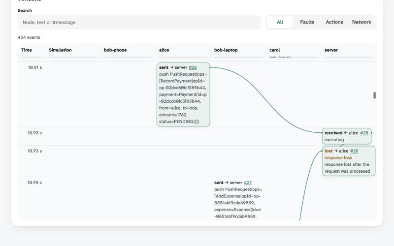

<p align="center"></p>

# SyncLab

**Run your real Kotlin sync code through thousands of seeded failure schedules in virtual time, and get
the smallest set of faults that breaks it plus a one-line replay.**

For Android and Kotlin Multiplatform teams with an offline outbox, Ktor retries, or anything that must
not be saved twice.

Your offline-first app works on your desk. Then a phone loses its response after the server already
applied the write, retries, and a shared bill gets counted twice. Or two devices disagree about the
time, and the later edit silently loses.

SyncLab runs your *real* sync code (clients, server logic, Ktor `HttpClient`, retry plugins) inside
a seeded, virtual-time simulation. It injects the failures that cause these bugs, checks your business
invariants after every step, and when something breaks it gives you a short story of what went wrong
and one line to replay it exactly.

```kotlin
// A sketch; the full, runnable version is examples/expense-ledger.
@Test
fun `ledger never double-counts`() = explore(runs = 200) {                // 200 seeds, each a different world
    val server = node("server") { LedgerServer().also { s -> serve<Push, Ack>("push") { _, req -> s.apply(req) } } }
    val phone  = node("phone")  { LedgerClient(api = rpc("server", "push"), disk = storage) }

    always("balances sum to zero") { server.app.balances().values.sum() == 0L }          // checked after every step
    eventuallyEqual("each expense lands exactly once", { phone.app.created }, { server.app.expenseIds })

    repeat(random.nextInt(5, 20)) { phone.perform("add expense") { addExpense(random.nextLong(100, 5_000)) } }
}
```

When it fails:

```
SyncLab found a problem (seed 3, at t=72.18s of virtual time).

  Did not converge: each expense a user added is on the server exactly once
    Still not true 1m after the network was healed.
      only in actual: e-0651abf9cdab9869-dup14

  Reproduces with only these fault types: RESPONSE_LOSS  (minimal for this seed: turning any one off hides it)

  Injected faults (2):
    t=   10.93s  server <- alice        drop    response lost after the request was processed  #26  [RESPONSE_LOSS]
    ...
  Reproduce exactly:
    SYNCLAB_REPLAY=SL1:3:DROP+DUPLICATE+REORDER:8f6654b3 ./gradlew test --tests "example.ledger.LedgerSyncTest"
```

The full trace is also written to a self-contained HTML viewer with one lane per device. Select a
message to see its journey: here, a push from `alice` reached the server, and the reply was lost.



## What it simulates

| Fault | What your code sees |
|---|---|
| `DROP` | A request or message never arrives; the caller times out. |
| `DUPLICATE` | The receiver gets a message twice, so a request is executed twice. |
| `RESPONSE_LOSS` | The server **processed** the request, but the reply is lost. This is the classic cause of double writes. |
| `REQUEST_FAILURE` | The request fails fast without being processed (like a 503). |
| `REORDER`, `DELAY` | Messages overtake each other; latency spikes. |
| `PARTITION` | Devices go offline or are cut off from each other, including mid-flight. |
| `CRASH` | A node loses its memory and in-flight work, then restarts from its durable storage. |
| `CLOCK_SKEW` | Device wall clocks disagree or jump. |
| `INTERLEAVING` | Events due at the same instant run in a seeded random order. |
| Your own | `network.intercept(FaultType("CORRUPT")) { msg, rnd -> Verdict.Replace(...) }` |

Every run is fully determined by its seed. There are no real sockets, threads or sleeps, so 200 runs
of a four-device ledger take about a second.

## Install

Not on Maven Central yet. Until the first release, build it locally with `./gradlew publishToMavenLocal`, then:

```kotlin
// build.gradle.kts
repositories { mavenLocal(); mavenCentral() }
dependencies {
    testImplementation("io.github.yeegz.synclab:synclab-core:0.1.0-SNAPSHOT")
    testImplementation("io.github.yeegz.synclab:synclab-junit5:0.1.0-SNAPSHOT")  // optional: exact test names
    testImplementation("io.github.yeegz.synclab:synclab-ktor:0.1.0-SNAPSHOT")    // optional: Ktor HttpClient adapter
    testRuntimeOnly("io.github.yeegz.synclab:synclab-report:0.1.0-SNAPSHOT")     // optional: HTML + JSON reports
}
```

**[Quick start (5 minutes)](docs/QUICKSTART.md)** · [What it can and cannot find](docs/CAPABILITIES.md) ·
[Adopting it in an existing app](docs/ADOPTING.md) · [Extending](docs/EXTENDING.md) · [Architecture](docs/ARCHITECTURE.md) ·
[CI](docs/CI.md) · [Benchmarks](docs/BENCHMARKS.md) · [Compatibility](docs/COMPATIBILITY.md) · [Versioning](docs/VERSIONING.md) ·
[Specification](docs/SPEC.md) · [Design](docs/DESIGN.md) · [Research](docs/research/RESEARCH.md) · [Roadmap](ROADMAP.md) · [Hand-off](docs/HANDOFF.md)

## Examples

Each example is ordinary app code, plus tests showing SyncLab passing the correct version and catching seeded bugs.

| Example | What it shows |
|---|---|
| [`examples/expense-ledger`](examples/expense-ledger) | Four devices, offline outbox, idempotency receipts, payment confirmation. It catches a non-idempotent server, ids regenerated on retry, and a double confirmation from two devices. |
| [`examples/offline-tasks`](examples/offline-tasks) | Last-writer-wins by device clock **loses edits under clock skew**, and SyncLab shows that `CLOCK_SKEW` is required. Hybrid logical clocks pass. |
| [`examples/collab-text`](examples/collab-text) | Index-based collaborative editing diverges, while a small sequence CRDT converges under loss, duplicates, reordering and partitions. |
| [`examples/ktor-sync`](examples/ktor-sync) | A real Ktor client with JSON, `HttpRequestRetry` and `HttpTimeout`, through the simulated network. It catches an ignored `Idempotency-Key`, and flags Ktor's default retry jitter as nondeterministic. |

## Honest limits

SyncLab tests the code you run inside it, under the failure model it implements. Passing thousands of
seeds is strong evidence, **not proof**, that your sync logic is correct. It does not exercise real TCP,
TLS, OS schedulers, real disks, or work your code hands to other threads (it detects and reports that
work instead). See [CAPABILITIES.md](docs/CAPABILITIES.md) for the full list.

## Status

`0.1.0-SNAPSHOT`, pre-release. The API may change before 1.0 (see [VERSIONING.md](docs/VERSIONING.md)).
Targets: JVM 11+, Kotlin/JS (Node), and Kotlin/Native (macOS, iOS, Linux).

Licensed under Apache 2.0.
